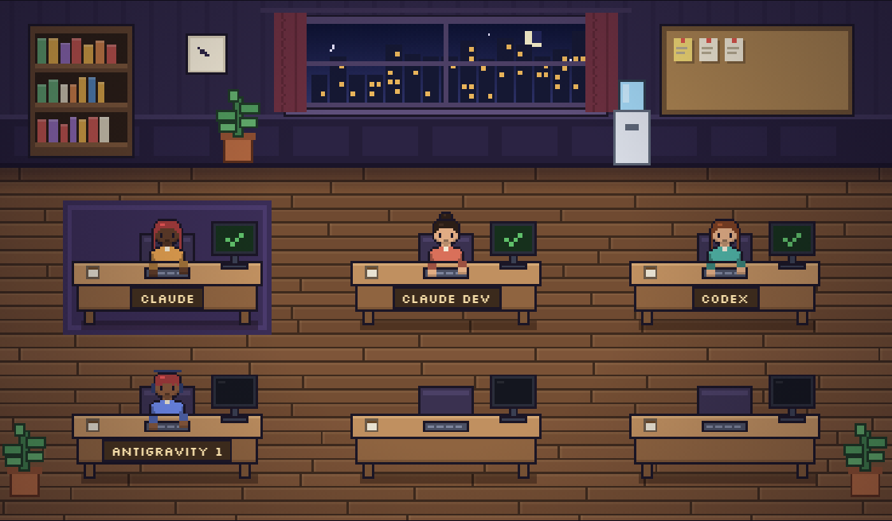

# VirtualOF

Um escritório virtual em pixel art para os seus agentes de IA. Você passa tarefas, aprova o que eles querem rodar e acompanha o trabalho, tudo numa página no navegador.

[Read in English](README.md)

## O que ele faz

- **Um comando geral, a equipe inteira.** Você escreve o que quer uma vez. O coordenador monta os passos na melhor ordem, o escritório passa cada passo para o agente certo, e depois de cada passo o coordenador pode refazer o resto do plano (por exemplo, para corrigir o que o revisor apontou). O plano aparece como uma lista ao vivo.
- **Você escolhe quem faz o quê.** Em **Configurações**, defina o papel de cada agente (coordenador, executor, revisor ou de folga), dê um apelido, escolha o modelo (Claude: Opus, Sonnet ou Haiku; Codex: os modelos da sua configuração; Gemini: o que `agy models` lista para a sua conta do Google) e a ordem das mesas. Dá para abrir direto em http://localhost:4321/#configuracoes. Qualquer um pode coordenar, inclusive o Codex.
- **Consumo à vista.** O painel **Consumo** mostra o limite da assinatura de cada conta (o Claude informa quanto da janela de 5 horas ou semanal você usou e quando renova; o Codex avisa quando bate o limite) e o gasto de cada agente: tarefas, tokens e quanto custaria pela API.
- **Troca automática no limite.** Se uma conta bater o limite no meio de um comando geral, um agente de outra conta assume aquele passo, ou a própria coordenação, e o plano continua.
- **Suas skills e plugins vão junto.** Os agentes Claude carregam as mesmas skills, plugins, servidores MCP e CLAUDE.md do seu Claude Code; o Codex usa a configuração dele em `~/.codex`. Cada mesa mostra o que o agente carregou.
- **Importe skills.** A janela **Skills** mostra as skills de cada ferramenta e instala uma nova a partir da pasta dela (ou só do SKILL.md) para o Claude, o Codex e/ou o Gemini, depois de mostrar o que ela diz. Importe só skills de quem você confia: elas podem trazer scripts que os agentes executam.
- **Deixe a sala do seu jeito.** A janela **Ambiente** escolhe o período do dia (noite, entardecer, dia), a cor da parede e o piso, mostra ou esconde o gato, o tapete, as plantas, a cafeteira e o rack, e coloca uma imagem sua na janela, desenhada em pixel art.
- **Ou fale direto com um agente.** Clique numa mesa, escreva a tarefa e mande. Sem terminal.
- **Claude e Codex juntos.** Dois agentes Claude rodam pelo [Claude Agent SDK](https://code.claude.com/docs/en/agent-sdk); o Codex roda pelo [Codex SDK](https://github.com/openai/codex/tree/main/sdk/typescript), só leitura a não ser que seja executor. O Gemini roda pelo [Antigravity CLI](https://antigravity.google/docs/cli/headless/) (`agy`) em modo headless e começa como reserva, pronto para cobrir quando outra conta bater o limite.
- **Permissões viram post-its.** Quando o Claude quer editar um arquivo ou rodar um comando, aparece um post-it com **Aprovar** e **Negar**.
- **PowerShell embutido.** Um terminal de verdade embaixo do escritório (botão **PowerShell** ou Ctrl + '), aberto na pasta do projeto.
- **Cartão "Precisa do terminal".** Se um agente precisar de algo que só você pode fazer (login, instalação, comando interativo), ele para e o escritório mostra o comando exato. Clique em **Rodar no PowerShell** para rodar no terminal embutido, depois em **Já rodei**, e ele continua.
- **Acompanha o Antigravity.** As conversas do Antigravity aparecem como personagens que se acendem quando estão trabalhando. É só acompanhamento: tarefas para o Antigravity continuam pelo próprio Antigravity.
- **Status ao vivo em cada mesa.** A tela, o balão e a luminária mostram se o agente está pensando, lendo, escrevendo, rodando comando, esperando você, terminou ou deu erro. Com a aba em segundo plano, chegam notificações do sistema.

## Primeiros passos

O VirtualOF **não é um site**: ele roda no seu computador, porque é daí que os agentes leem e mudam os seus arquivos e usam as suas contas. A janela (ou o navegador) é só a tela dele.

### Jeito 1: instalar o app (Windows)

1. Baixe o `VirtualOF-Setup.exe` em [Releases](https://github.com/YamoToComBronquite/VirtualOF/releases) e instale.
2. Abra o **VirtualOF** pelo menu Iniciar. Fechar a janela desliga o escritório e os agentes.
3. Clique em **Escolher…**, selecione a pasta do projeto e mande uma tarefa.

O instalador já traz tudo o que precisa (inclusive os motores do Claude Code e do Codex), por isso é grande.

O app se atualiza sozinho: ao abrir (e a cada 4 horas) ele confere se há versão nova em Releases, baixa em segundo plano e pergunta se pode reiniciar. Suas configurações continuam.

O app não tem certificado de assinatura, então na primeira instalação o Windows mostra "O Windows protegeu o seu computador". Clique em **Mais informações → Executar assim mesmo**.

### Jeito 2: rodar pelo código

1. Instale o [Node.js](https://nodejs.org) 22 ou mais novo.
2. Baixe o projeto: botão **Code → Download ZIP** no GitHub, ou `git clone https://github.com/YamoToComBronquite/VirtualOF.git`.
3. No Windows, dê dois cliques em `Abrir escritorio.cmd`. Em outros sistemas, rode `npm install` e depois `npm start -- --abrir` dentro da pasta.
4. O navegador abre em http://localhost:4321. Deixe a janela preta aberta: fechar ela desliga o escritório.

Para gerar o instalador você mesmo, rode `npm run dist` (ele sai em `release/`).

Para lançar uma versão nova: aumente a `version` no `package.json` e rode `npm run release` com um token do GitHub em `GH_TOKEN`. Ele publica `VirtualOF-Setup.exe`, `VirtualOF-Setup.exe.blockmap` e `latest.yml` numa Release, e os apps instalados pegam a atualização.

### Contas

Cada pessoa usa as próprias assinaturas, e os agentes gastam os limites de sempre:

- **Claude:** uma conta logada no Claude Code neste computador (CLI ou extensão da IDE), ou uma `ANTHROPIC_API_KEY`.
- **Codex:** uma conta do ChatGPT. Se faltar o login, o escritório mostra o comando no cartão **Precisa do terminal**, pronto para rodar no PowerShell embutido.
- **Gemini:** o [Antigravity CLI](https://antigravity.google/docs/getting-started) (`agy`), logado com sua conta do Google (rode `agy` uma vez no PowerShell embutido; o login é separado do IDE). Se faltar, o escritório mostra o comando de instalação.
- **Opcional:** o [Antigravity](https://antigravity.google), para ver as conversas do IDE no escritório.

Vários agentes trabalhando ao mesmo tempo gastam esses limites mais rápido.

## Configuração

Tudo fica em `escritorio.config.json`:

| Chave | O que define |
| --- | --- |
| `porta` | Porta do servidor local (padrão `4321`) |
| `papeis` | Instruções de cada papel: `coordenador`, `executor`, `revisor` |
| `agentes` | A equipe: `id`, `nome`, `tipo` (`claude` ou `codex`), `papel` (papel inicial) e `cor` (cor da camisa) |
| `antigravity.pasta` | Onde o Antigravity guarda as conversas (`~/.gemini/antigravity-ide/conversations`) |
| `antigravity.ativoSegundos` | Há quantos segundos a conversa precisa ter mudado para contar como "trabalhando" |
| `antigravity.maximo` | Quantas conversas do Antigravity mostrar |

O que você muda na página (pasta do projeto, papéis, ordem das mesas, troca automática) fica salvo em `.escritorio.local.json`, que não vai para o git.

## Segurança

Os agentes podem ler e alterar arquivos e rodar comandos no seu computador. Por isso:

- O servidor só escuta em `127.0.0.1`, e o WebSocket só aceita conexões da própria página do escritório.
- Toda ação do Claude que precisa de permissão passa por um post-it que você aprova.
- O Codex não tem aprovação por ação nesse modo, então roda em sandbox `read-only`, a não ser quando é executor (ou cobre um). Como executor ele pode editar arquivos do projeto sem post-it; a tela de Configurações avisa isso.
- O Antigravity é só observado: o escritório vê quando os arquivos de conversa mudam e nunca abre nem altera esses arquivos.

## Próximos passos

- Fluxo de projeto novo com seletor de pasta e `git init`
- Um checkpoint no git antes de cada tarefa, com botão **Desfazer tarefa**, e o Codex revisando exatamente esse diff
- Versão aplicativo de desktop

## Aviso

O VirtualOF é um projeto independente, sem vínculo com Anthropic, OpenAI ou Google. Claude, Codex e Antigravity são marcas dos seus respectivos donos.

## Licença

[MIT](LICENSE)
